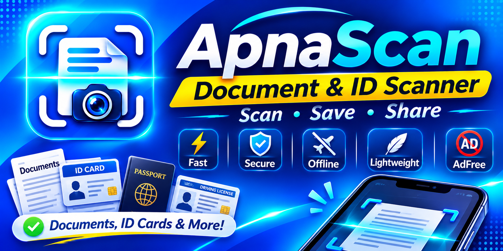

<div align="center">
  
   ApnaScan: High-Performance Offline Document Scanner

  **A fast, secure, and privacy-first Android document scanner built with native Kotlin, Jetpack Compose, CameraX, Google AI Edge LiteRT, OpenCV, and ML Kit.**

  [-3DDC84?logo=android&logoColor=white)](#build-configuration)
  [](#architecture)
  [](#architecture)
  [](#privacy--offline-first-experience)
  [](#high-performance-processing)
  [](#license)

  <p align="center">
    <a href="#-key-features">Key Features</a> •
    <a href="#-high-performance-processing">High-Performance Processing</a> •
    <a href="#-flexible-pdf-export">Flexible PDF Export</a> •
    <a href="#-annotation-studio">Annotation Studio</a> •
    <a href="#-architecture">Architecture</a> •
    <a href="#-localization-support">Localization Support</a> •
    <a href="#-privacy--offline-first-experience">Privacy</a> •
    <a href="#-build-configuration">Build Configuration</a>
  </p>
</div>

---

## 📖 Overview

**ApnaScan** is a modern Android document scanning application designed for users who need fast, reliable, and high-quality document digitization without compromising their privacy.

Built with native Android technologies, ApnaScan combines intelligent camera capture, advanced image processing, non-destructive editing, QR and barcode recognition, and flexible PDF generation in one lightweight application.

Unlike cloud-dependent scanning solutions, ApnaScan performs its core scanning, image processing, editing, and document management operations directly on the device.

With no application-level Internet permission, documents remain stored locally within the application's private storage. Your scans stay under your control rather than being routinely uploaded to remote servers.

---

## 🌟 Key Features

### 📷 1. Intelligent Hardware Capture
* **Native CameraX Engine**: Direct integration with Android's CameraX subsystem (`camera-camera2`, `camera-lifecycle`) providing hardware-negotiated resolution selection, continuous auto-focus, pinch-to-zoom, and torch controls.
* **Dynamic Hardware Negotiation**:
  * **HD (Fast)**: Optimized for ultra-low latency and quick multi-page snapping.
  * **FHD (Standard)**: Balanced high-resolution capture for typical day-to-day scanning.
  * **UHD (High)**: Maximum sensor resolution capture for fine text and legal documents.
* **Multiple Capture Modes**:
  * **DOCS Mode**: Automated document capture with aspect-ratio locking and edge snapping.
  * **ID Card Mode**: Specialized workflows for dual-sided identity cards (Front/Back) and single-sided cards with on-screen alignment guides.
* **ML Kit Document Scanner**: Google ML Kit Document Scanner integration, powered by Google Play services. Required components may be downloaded when first used.
* **Batch Scanning**: Rapid multi-page capture supporting sessions of 50+ pages with live slot management.

### 🎨 2. Advanced Non-Destructive Editing Studio
* **Magnetic Edge Cropping**: 4-point manual corner adjustment with magnified loupe preview and automatic boundary snapping.
* **Non-Destructive Rotation**: 90-degree rotations are stored as editing metadata without modifying the original captured image.
* **Professional Color Filters**:
  * **Original**: Preserves the original captured image without applying enhancement filters.
  * **Magic Color**: High-contrast color enhancement designed to pop text while preserving photo elements.
  * **Paper / Clean White**: Removes page shadows and yellow tints, rendering clean, bright paper backgrounds.
  * **Card / ID**: Optimized for ID card holograms, micro-print, and high-frequency patterns.
  * **B&W (Binarization)**: High-precision Otsu thresholding for ultra-crisp, printer-ready monochrome text.
  * **Grayscale**: Smooth 8-bit tonal reduction.
* **Fine-Tuning Sliders**: Individual non-destructive adjustment for **Contrast**, **Brightness**, **Saturation**, and **Sharpness**.

### 🔍 3. QR & Barcode Recognition
* **On-Device Vision**: Integrated lightweight Google Play Services ML Kit Barcode Scanning (~200KB overhead).
* **Instant Extraction**: Scan barcodes and QR codes from existing scanned documents with one-tap copy.

---

## ⚡ High-Performance Processing

ApnaScan adheres to a strict performance, memory-safety, and battery-saver standard across all image transformations.

```
+-----------------------------------------------------------------------------------+
|                            Optimized On-Device Pixel Pipeline                               |
+-----------------------------------------------------------------------------------+
  [ Camera / File Input ]
            |
            v
  [ Sandbox Internal Storage ]  <--- (Original Captured Image (Master File) Saved)
            |
            v
  [ Coroutine Dispatcher.IO ]   <--- (Off-Thread Perspective Warp & Filtering)
            |
            v
  [ Non-Destructive JSON State ] <--- (Corners, Rotation, Sliders Stored as Metadata)
            |
            v
  [ Display Cache (Indexed/File) ] <--- (Immediate UI Feedback, Zero Main-Thread Janks)
            |
            v
  [ Direct Stream PDF Output ]  <--- (Native In-Memory Assembly & Jpeg Compression)
+-----------------------------------------------------------------------------------+
```

### Architectural Highlights:
* **Non-Destructive Metadata Architecture**: Original Captured Image (Master File) are stored untouched in sandboxed internal storage. All crops, rotations, filters, and annotations are maintained as immutable JSON metadata states. Edits can be adjusted or reverted at any point without degrading image quality.
* **Dual-Layer Caching Engine**:
  * **Display Render Cache**: Processed screen thumbnails and previews are cached on disk. Opening an existing document fetches instant cached previews without re-running CPU-intensive image filters.
  * **PDF Hash Cache (`currentHash`)**: Document changes are fingerprinted. If a user exports an unmodified document twice, the compiled PDF is served instantly from cache.
* **16KB Page-Size Compatibility**: The application targets compatibility with Android devices using 16KB memory pages. Native libraries, including OpenCV and other packaged dependencies,meet the required ELF alignment and packaging requirements..
* **Hardware Accelerated Offscreen Rendering**: Efficient Offscreen Rendering: Image composition, watermarking, and annotation rendering use native Android Canvas operations and bitmap processing with controlled memory management.
Background Processing: Kotlin Coroutines and dedicated dispatchers keep computationally intensive image transformations and PDF generation away from the main UI thread.

---

## 📄 Flexible PDF Export

The PDF export engine provides deep configuration options to meet both personal and enterprise documentation standards:

| Configuration | Options Available | Details |
| :--- | :--- | :--- |
| **Page Sizes** | `Original`, `Auto`, `A4`, `Letter`, `Legal` | `Original` preserves exact 1:1 image geometry; standard sizes fit documents neatly into printable paper sheets. |
| **Orientation** | `Portrait`, `Landscape`, `Auto` | Dynamically auto-detects page aspect ratios or enforces unified orientation. |
| **Resolution (DPI)** | `72 DPI` (Fast/Draft), `150 DPI` (Standard), `300 DPI` (Print Quality) | Generates crisp text at 300 DPI or compact file sizes for email at 72/150 DPI. |
| **JPEG Quality** | `40%` to `95%` | Fine-grain compression control to target specific upload size limits. |
| **Card Layouts** | `Grid` (2-up), `Stack` (Side-by-side) | Formats Front & Back of ID cards on a single clean page. |
| **Security** | Password Protection (RC4-based PDF 1.4 encryption) | Native PDF 1.4 encryption protects sensitive documents with user/owner passwords. |
| **Custom Watermark** | Any text / Unicode | Diagonally centered (-45°) with subtle ~18% opacity; keeps document content 100% legible. |
| **Page Numbering** | `1 / N` Clean Footer | Smart positioning: on `Original` pages, dynamically appends an extra bottom strip so page numbers never overlap or obscure document text. |
| **Actions** | Share, Save to Documents, Print | Direct Android share sheet, MediaStore public document storage, or direct printer dispatch via `PrintManager`. |

---

<a id="annotation-studio"></a>
<a id="-annotation-studio"></a>
## ✍ Annotation Studio

ApnaScan includes a built-in on-device markup and digital signature studio:

* **Pen & Signature**: Free-hand vector drawing with simulated pressure-based stroke width. Quick access signature drawer for signing contracts, receipts, and forms.
* **Highlighter & Marker**: Translucent highlighting brush with customizable stroke widths (2dp to 50dp) and smooth alpha blending.
* **Smart Eraser**: Erases annotation vectors and stroke paths only, leaving the underlying document image pristine.
* **Text Annotation**: Insert typed labels, dates, and notes with customizable typography, sizing, and colors.
* **Color Palette & Eyedropper**: 8 curated document markup colors plus an interactive eyedropper tool to pick any exact color from the document canvas.
* **Undo / Redo History**: Complete stroke-by-stroke undo/redo stack and one-tap canvas clearing.

---

<a id="architecture"></a>
<a id="-architecture"></a>
## 🏗 Architecture

ApnaScan is architected using Modern Android Development (MAD) best practices, following **Clean Architecture** and **Unidirectional Data Flow (UDF)**.

```
android/app/src/main/java/com/apnascan/
├── ApnaScanApplication.kt          # Application class, Hilt dependency root
├── MainActivity.kt                 # Single-activity container, Edge-to-Edge setup
├── data/                           # Data layer (Entities, DataStore, Repositories)
│   ├── ScannerMode.kt              # Modes: DOCUMENT, CARD
│   ├── Slot.kt                     # Document page model with bitmap/path references
│   └── FilterType.kt               # Image filter definitions
├── domain/                         # Business logic & Use Cases
│   ├── ExportPdfUseCase.kt         # PDF compilation coordination
│   ├── SaveDocumentUseCase.kt       # Document persistence & JSON metadata storage
│   └── AnnotationManager.kt        # Vector stroke management and JSON serialization
├── presentation/                   # UI Layer (Jetpack Compose, ViewModels)
│   ├── scanner/                    # Camera capture, ScannerViewModel, ExportHelper
│   ├── components/                 # Reusable Compose buttons, dialogs, sliders
│   └── dialogs/                    # ExportModalDialog, SettingsDialog, AboutDialog
├── ui/                             # Screens & Custom Layouts
│   ├── CaptureScreen.kt            # Live camera view, shutter, and guide overlays
│   ├── EditorScreen.kt             # Filter picker, tuning sliders, crop entry
│   ├── CropScreen.kt               # 4-point magnetic corner perspective warp
│   ├── DocumentGrid.kt             # Multi-page overview, reordering, batch export
│   └── theme/                      # Material 3 Color Schemes, Typography, Shapes
└── util/                           # Utilities & Native Bridges
    ├── PdfExporter.kt              # High-performance native PDF stream generation
    ├── OpenCVHelper.kt             # Native edge detection & perspective transformation
    └── DiagnosticsLogger.kt        # Lightweight zero-allocation diagnostics logger
```

### Core Technologies:
* **Jetpack Compose & Material 3**: 100% declarative UI with edge-to-edge layout, responsive animations, and Day/Night dynamic color theming.
* **Dagger Hilt (`2.60.1`)**: Compile-time dependency injection across ViewModels, UseCases, and Repositories.
* **Kotlin Coroutines & Flow**: Structured concurrency for all background processing, preventing main thread frame drops.
* **OpenCV 4.11.0**: Tailored lightweight AAR stripped for `arm64-v8a` (~6MB) for contour identification and homography warping.
* **Google AI Edge LiteRT (`2.3.0`)**: High-efficiency on-device AI runtime with 16KB page-alignment support.
* **Coil 3 (`3.6.3`)**: Asynchronous, memory-cached image rendering in Compose.

---

<a id="privacy--offline-first-experience"></a>
<a id="privacy-offline-first-experience"></a>
<a id="-privacy--offline-first-experience"></a>
<a id="-privacy-offline-first-experience"></a>
## 🔒 Privacy & Offline-First Experience

Privacy is a core design principle of ApnaScan. The application is designed to keep scanned documents and core processing operations on the user's device.

* 🚫 **No Application-Level Internet Permission**: `android.permission.INTERNET` is **NOT** present in `AndroidManifest.xml`. The app cannot connect to the internet, make HTTP requests, or leak data.
* 🛡️ **Zero Analytics / Telemetry**: No Google Analytics, no Firebase Crashlytics, no Facebook SDK, and no background tracking daemons.
* 📁 **Sandboxed Local Storage**: Scans are stored in private internal application storage (`Context.filesDir`). Other apps cannot access your scanned documents.
* 🔐 **Hardware Sandboxing**: Camera access is used exclusively during active scanning sessions and is released immediately when switching screens or backgrounding the app.

---

## 🌍 Localization Support

ApnaScan provides full multi-language localization with native Right-to-Left (RTL) mirroring:

| Language | Locale Code | Direction | Native Name |
| :--- | :--- | :--- | :--- |
| **English** | `en` | LTR | English |
| **Urdu** | `ur` | RTL | اردو |
| **Sindhi** | `sd` | RTL | سنڌي |
| **Hindi** | `hi` | LTR | हिन्दी |

* Supported locales are declared in `res/xml/locales_config.xml`, supporting Android 13+ per-app language preferences.
* UI elements, action buttons, dialogs, hints, and error alerts dynamically mirror their layouts when an RTL locale is active.

---

<a id="build-configuration"></a>
<a id="-build-configuration"></a>
## 🛠 Build Configuration

### Prerequisites
* **Android Studio**: Ladybug / Meerkat or newer
* **JDK**: Java 17 (Azul Zulu or OpenJDK recommended)
* **Android SDK**: Compile SDK `37`, Target SDK `37`, Min SDK `26` (Android 8.0 Oreo)
* **NDK**: Version `28.x+` (Default ABI filter: `arm64-v8a`)

### Build Steps

#### 1. Clone the repository
```bash
git clone git clone https://github.com/girdhari-jaat/ApnaScan.git
cd ApnaScan/android
```

#### 2. Assemble Debug APK
```bash
./gradlew assembleDebug
```
The debug APK will be generated at:
`app/build/outputs/apk/debug/app-debug.apk`

#### 3. Assemble Release APK / AAB
To build an optimized release bundle signed with your keystore:
```bash
# Generate Release AAB (for Google Play Console)
./gradlew :app:bundleRelease

# Or Generate Release APK (for Direct Sideloading)
./gradlew :app:assembleRelease
```

The output artifacts will be located at:
* **AAB**: `app/build/outputs/bundle/release/app-release.aab`
* **APK**: `app/build/outputs/apk/release/app-release.apk`

### ProGuard & Shrinking
Release builds have `isMinifyEnabled = true` and `isShrinkResources = true` enabled with customized rules in `proguard-rules.pro` to preserve OpenCV JNI bindings, LiteRT runtimes, and ML Kit interfaces while stripping unused symbols and debug logs.

---

## 📄 License

```ApnaScan – User License & Terms
ApnaScan is proprietary software.
Copyright (c) 2026 ApnaScan. All Rights Reserved.
The application and its original source code, design, branding, and associated intellectual property are owned by the author.
Terms of Use
Free Use: ApnaScan is currently available free of charge. The author reserves the right to introduce paid features, subscriptions, or other pricing models in future versions.
Ownership: All rights, title, and interest in ApnaScan and its original intellectual property remain with the author.
Restrictions: Unauthorized copying, modification, redistribution, reverse engineering, or creation of derivative works is prohibited, except where expressly permitted by applicable law.
Disclaimer: The software is provided "AS IS", without warranties of any kind, express or implied. The author shall not be liable for damages arising from its use to the extent permitted by applicable law.

```

*ApnaScan incorporates third-party libraries and technologies, including OpenCV, Google AI Edge LiteRT, Google ML Kit, AndroidX, and Coil.
These components remain subject to their respective licenses and copyright notices. Their licenses are separate from the proprietary license governing ApnaScan's original application code.
For applicable third-party license information, refer to the respective upstream projects and included license notices.*


ApnaScan — Scan Smart. Stay Private.
Fast • Secure • Offline-First • Lightweight • Ad-Free