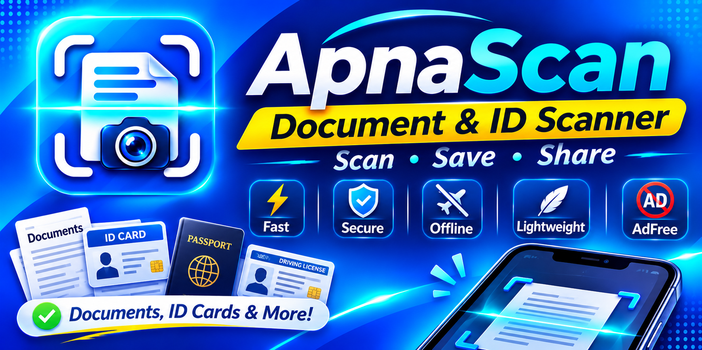

<div align="center">
  
  # ApnaScan: High-Performance Offline Document Scanner

  **A fast, secure, and privacy-first Android document scanner built with native Kotlin, Jetpack Compose, CameraX, Google AI Edge LiteRT, OpenCV, and ML Kit.**

  [-3DDC84?logo=android&logoColor=white)](#build-configuration)
  [](#architecture)
  [](#architecture)
  [](#privacy--offline-first-experience)
  [](#high-performance-processing)
  [](#license)

  <p align="center">
    <a href="#-key-features">Key Features</a> •
    <a href="#-high-performance-processing">High-Performance Processing</a> •
    <a href="#-flexible-pdf-export">Flexible PDF Export</a> •
    <a href="#-annotation-studio">Annotation Studio</a> •
    <a href="#-architecture">Architecture</a> •
    <a href="#-localization-support">Localization Support</a> •
    <a href="#-privacy--offline-first-experience">Privacy</a> •
    <a href="#-build-configuration">Build Configuration</a>
  </p>
</div>

---

## 📖 Overview

**ApnaScan** is a modern Android document scanning application designed for users who need fast, reliable, and high-quality document digitization without compromising their privacy.

Built with native Android technologies, ApnaScan combines intelligent camera capture, advanced image processing, non-destructive editing, QR and barcode recognition, and flexible PDF generation in one lightweight application.

Unlike cloud-dependent scanning solutions, ApnaScan performs its core scanning, image processing, editing, and document management operations directly on the device.

With no application-level Internet permission, documents remain stored locally within the application's private storage. Your scans stay under your control rather than being routinely uploaded to remote servers.

---

## 🌟 Key Features

### 📷 1. Intelligent Hardware Capture
* **Native CameraX Engine**: Direct integration with Android's CameraX subsystem (`camera-camera2`, `camera-lifecycle`, `camera-extensions`) providing hardware-negotiated resolution selection (`PREVIEW` at `1440×1080`, `IMAGE_ANALYSIS` at `960×720`), continuous/tap auto-focus, pinch-to-zoom, and torch controls.
* **Dynamic Hardware Negotiation (Saved Per Device)**:
  * **HD (`Fast`)**: Optimized ~3 MP (`2048×1536`) capture for ultra-low latency and quick multi-page snapping.
  * **FHD (`Standard`)**: Balanced ~5 MP (`2592×1944`) capture for typical day-to-day scanning.
  * **UHD (`High`)**: High-clarity ~8 MP (`3264×2448`, strictly capped at 8 MP) capture for fine text and legal documents.
* **Multiple Capture Modes**:
  * **Document Mode**: Automated document capture with live contour snapping and multi-page scanning.
  * **Card Mode**: Specialized workflow for single or dual-sided identity cards (Front/Back) on Portrait A4 sheets with on-screen alignment guides.
* **ML Kit Document Scanner**: Google ML Kit Document Scanner integration, powered by Google Play services. Required components may be downloaded when first used.
* **Batch Scanning**: Rapid multi-page capture supporting multi-page document sessions with live slot management.

### 🎨 2. Advanced Non-Destructive Editing Studio
* **Magnetic Edge Cropping**: 4-point manual corner adjustment with magnified loupe preview and automatic boundary snapping.
* **Non-Destructive Rotation**: 90-degree rotations are stored as editing metadata without modifying the original captured image.
* **9 Professional Image Filters**:
  * **Original**: Preserves the original captured image without applying enhancement filters.
  * **Magic**: High-contrast color enhancement designed to pop text while preserving photo elements.
  * **Vivid**: Enhanced color saturation and crisp contrast for colorful documents.
  * **Card**: Optimized for ID card holograms, micro-print, and high-frequency patterns.
  * **Paper**: Removes page shadows and yellow tints, rendering clean, bright paper backgrounds.
  * **B&W**: High-precision Otsu thresholding for crisp, printer-ready monochrome text.
  * **B&W 2**: Refined adaptive monochrome contrast enhancement for clean document prints.
  * **Gray**: Smooth 8-bit tonal grayscale reduction.
  * **Gray 2**: Contrast-balanced grayscale optimized for faint text and pencil marks.
* **Fine-Tuning Sliders**: Individual non-destructive adjustment for **Contrast**, **Brightness**, **Saturation**, and **Sharpness**.

### 🔍 3. QR & Barcode Recognition
* **On-Device Vision**: Integrated lightweight Google Play Services ML Kit Barcode Scanning (~200KB overhead).
* **Instant Extraction**: Scan barcodes and QR codes from existing scanned documents with one-tap copy.

---

## ⚡ High-Performance Processing

ApnaScan adheres to a strict performance, memory-safety, and battery-saver standard across all image transformations.

```
+-----------------------------------------------------------------------------------+
|                            Optimized On-Device Pixel Pipeline                               |
+-----------------------------------------------------------------------------------+
  [ Camera / File Input ]
            |
            v
  [ App-Specific Storage ]       <--- (Original Master Files & JSON Saved in ExternalFilesDir)
            |
            v
  [ Coroutine Dispatcher.IO ]   <--- (Off-Thread Perspective Warp & Filtering)
            |
            v
  [ Non-Destructive JSON State ] <--- (Corners, Rotation, Sliders Stored as Metadata)
            |
            v
  [ Display Cache (Disk/Memory) ] <--- (Immediate UI Feedback, Zero Main-Thread Janks)
            |
            v
  [ Direct Stream PDF Output ]  <--- (Native Stream Assembly & JPEG Compression)
+-----------------------------------------------------------------------------------+
```

### Architectural Highlights:
* **Non-Destructive Metadata Architecture**: Original captured master files are stored untouched in app-specific sandboxed storage (`Context.getExternalFilesDir("ScannedDocuments")`). All crops, rotations, filters, and annotations are maintained as JSON metadata states, so edits can be adjusted or reverted without degrading image quality.
* **Dual-Layer Caching Engine**:
  * **Display Render Cache**: Processed screen thumbnails and previews are cached on disk (`previews/` and `thumbs/`). Opening an existing document fetches cached previews without re-running CPU-intensive filters.
  * **PDF Hash Cache (`currentHash`)**: Document edits and export parameters are fingerprinted. Exporting an unmodified document twice serves the compiled PDF directly from cache.
* **16KB Page-Size Compatibility**: Native libraries, including OpenCV and LiteRT, are packaged uncompressed (`useLegacyPackaging = false`) and 16KB ELF page-aligned for modern Android devices.
* **Hardware Accelerated Offscreen Rendering**: Image composition, watermarking, and annotation rendering use native Android `Canvas` operations and bounded bitmap management.
* **Background Processing**: Kotlin Coroutines (`Dispatchers.IO` / `Dispatchers.Default`) keep computationally intensive image transformations and PDF generation away from the main UI thread.

---

## 📄 Flexible PDF Export

The PDF export engine provides deep configuration options to meet both personal and enterprise documentation standards:

| Configuration | Options Available | Details |
| :--- | :--- | :--- |
| **Page Sizes** | `Original`, `Auto`, `A4`, `Letter`, `Legal` | `Original` preserves exact 1:1 image geometry; `Auto` picks the best-fitting standard size (`A4`, `Letter`, `Legal`) regardless of portrait or landscape orientation. |
| **Orientation** | `Auto`, `Portrait`, `Landscape` | Dynamically follows page/scan aspect ratios or enforces unified orientation. |
| **Resolution (DPI)** | `150 DPI` to `300 DPI` (`150`, `200`, `250`, `300`) | Generates crisp print-quality text at 300 DPI or compact files at 150 DPI. |
| **JPEG Quality** | `60%` to `100%` | Adjustable compression slider (`60%`, `70%`, `80%`, `90%`, `100%`) to balance quality and file size. |
| **Card Layouts** | `ID`, `2x4`, `Grid` | Formats Front & Back (`ID`), 4 repeated pairs (`2x4`), or sequential multi-card sheets (`Grid`) on Portrait A4 sheets. |
| **Security** | Password Protection (RC4-based PDF 1.4 encryption) | Native PDF 1.4 encryption protects sensitive documents with user/owner passwords. |
| **Custom Watermark** | Any text / Unicode | Diagonally centered (-45°) with subtle ~18% opacity; keeps document content legible. |
| **Page Numbering** | `1 / N` Clean Footer | Smart positioning: on `Original` pages, dynamically appends an extra bottom strip so page numbers never overlap document text. |
| **Actions** | Share, Save PDF / Export to Documents, Print | Android share sheet, `MediaStore` (`Documents/ApnaScan`), and system printing via `PrintManager`. |

---

<a id="annotation-studio"></a>
<a id="-annotation-studio"></a>
## ✍ Annotation Studio

ApnaScan includes a built-in on-device markup and digital signature studio:

* **Pen & Signature**: Free-hand vector drawing with adjustable stroke width (`2` to `50`) and opacity (`10%` to `100%`) for signing contracts, receipts, and forms.
* **Brush & Highlighting**: Soft translucent brush/marker strokes with customizable size (`2` to `50`) and alpha blending.
* **Smart Eraser**: Erases annotation vectors and stroke paths only, leaving the underlying document image untouched.
* **Text Annotation (`TT`)**: Insert typed labels, dates, and notes with customizable sizing, opacity, and colors.
* **Color Palette & Eyedropper**: 8 curated document markup colors plus an interactive eyedropper tool to pick any exact color from the document canvas.
* **Undo / Redo History**: Complete stroke-by-stroke undo/redo stack and one-tap canvas clearing.

---

<a id="architecture"></a>
<a id="-architecture"></a>
## 🏗 Architecture

ApnaScan is architected using Modern Android Development (MAD) best practices, following **Clean Architecture** and **Unidirectional Data Flow (UDF)**.

```
android/app/src/main/java/com/apnascan/
├── ApnaScanApplication.kt          # Application class, Hilt dependency root
├── MainActivity.kt                 # Single-activity container, edge-to-edge setup
├── OverlayView.kt                  # Custom camera contour & alignment guide overlay
├── core/                           # Result wrappers, crash handler, DiagnosticsLogger
├── data/                           # Repositories, DataStore, MediaStore, Annotation & Slot models
│   ├── ScannerMode.kt              # Modes: DOCUMENT, CARD
│   ├── Slot.kt                     # Document page model with bitmap/path references
│   ├── FilterType.kt               # 9 document & card filter definitions
│   └── AnnotationManager.kt        # Vector stroke management & JSON serialization
├── di/                             # Hilt dependency injection modules
├── domain/                         # Processing & PDF engine + UseCases
│   ├── ImageProcessor.kt           # Perspective warp, Otsu B&W, color & card filter pipeline
│   ├── PdfExporter.kt              # Native PDF stream generator & card sheet compositor
│   ├── ExportHelper.kt             # Share intents, NativePdfWriter & RC4 PDF encryption
│   └── usecase/                    # DetectEdgesUseCase, ExportPdfUseCase, SaveDocumentUseCase
├── scanner/                        # ViewModel, state handlers & CV/AI detection engines
│   ├── ScannerViewModel.kt         # StateFlow coordination across scanner/crop/editor flows
│   ├── CameraHardwareConfig.kt     # Persistent camera hardware negotiation (<= 8 MP cap)
│   ├── DocCornerNetEngine.kt       # On-device LiteRT neural corner segmentation
│   └── CvContourQuadDetector.kt    # OpenCV contour & RANSAC quad detector
├── ui/                             # Camera Fragment + Jetpack Compose screens & dialogs
│   ├── ScannerFragment.kt          # CameraX lifecycle & PreviewView host
│   ├── CropScreen.kt               # 4-point magnetic corner perspective warp + loupe
│   ├── EditorScreen.kt             # Filter picker, tuning sliders, annotation studio
│   ├── DocumentGrid.kt             # Multi-page overview, reordering, batch export
│   ├── LibraryScreen.kt            # Saved documents library & search
│   ├── ExportModalDialog.kt        # PDF export options dialog
│   ├── SettingsScreen.kt           # App preferences & localization settings
│   └── theme/                      # Material 3 Color Schemes, Typography, Shapes
└── utils/                          # PageConfig, LocalizationUtils, ShutterSoundPlayer, Haptics
```

### Core Technologies:
* **Jetpack Compose & Material 3 (with CameraX Fragment)**: Declarative Compose UI for screens, dialogs, editor, and crop studio paired with a `Fragment`/`PreviewView` camera host, edge-to-edge layout, and Day/Night color theming.
* **Dagger Hilt (`2.60.1`)**: Compile-time dependency injection across ViewModels, UseCases, and Repositories.
* **Kotlin Coroutines & Flow**: Structured concurrency for background image processing and PDF export, preventing main-thread frame drops.
* **OpenCV 4.11.0**: Tailored lightweight AAR stripped for `arm64-v8a` (~6MB) for contour identification and homography warping.
* **Google AI Edge LiteRT (`2.3.0`)**: High-efficiency on-device AI runtime (`assets/model_int8.tflite`) with 16KB page-alignment support.
* **Coil 3 (`3.6.3`)**: Asynchronous, memory-cached image rendering in Compose.

---

<a id="privacy--offline-first-experience"></a>
<a id="privacy-offline-first-experience"></a>
<a id="-privacy--offline-first-experience"></a>
<a id="-privacy-offline-first-experience"></a>
## 🔒 Privacy & Offline-First Experience

Privacy is a core design principle of ApnaScan. The application is designed to keep scanned documents and core processing operations on the user's device.

* 🚫 **No Application-Level Internet Permission**: `android.permission.INTERNET` is **NOT** present in `AndroidManifest.xml`. The app cannot connect to the internet, make HTTP requests, or leak data.
* 🛡️ **Zero Analytics / Telemetry**: No Google Analytics, no Firebase Crashlytics, no Facebook SDK, and no background tracking daemons.
* 📁 **App-Specific Sandboxed Storage**: Working scans and session files are stored in app-specific sandboxed storage (`Context.getExternalFilesDir`), keeping them isolated from other apps on modern Android while exported PDFs/JPGs are written only when you explicitly choose to save or share.
* 🔐 **Hardware Sandboxing**: Camera access is used exclusively during active scanning sessions and is released immediately when switching screens or backgrounding the app.

---

## 🌍 Localization Support

ApnaScan provides full multi-language localization with native Right-to-Left (RTL) mirroring:

| Language | Locale Code | Direction | Native Name |
| :--- | :--- | :--- | :--- |
| **English** | `en` | LTR | English |
| **Urdu** | `ur` | RTL | اردو |
| **Sindhi** | `sd` | RTL | سنڌي |
| **Hindi** | `hi` | LTR | हिन्दी |

* Supported locales are declared in `res/xml/locales_config.xml`, supporting Android 13+ per-app language preferences.
* UI elements, action buttons, dialogs, hints, and error alerts dynamically mirror their layouts when an RTL locale is active.

---

<a id="build-configuration"></a>
<a id="-build-configuration"></a>
## 🛠 Build Configuration

### Prerequisites
* **Android Studio**: Ladybug / Meerkat or newer
* **JDK**: Java 17 (Azul Zulu or OpenJDK recommended)
* **Android SDK**: Compile SDK `37`, Target SDK `37`, Min SDK `26` (Android 8.0 Oreo)
* **NDK**: Version `28.x+` (Default ABI filter: `arm64-v8a`)

### ProGuard & Shrinking
Release builds have `isMinifyEnabled = true` and `isShrinkResources = true` enabled with customized rules in `proguard-rules.pro` to preserve OpenCV JNI bindings, LiteRT runtimes, and ML Kit interfaces while stripping unused symbols and debug logs.

---

## 📄 License

```ApnaScan – User License & Terms
ApnaScan is proprietary software.
Copyright (c) 2026 ApnaScan. All Rights Reserved.
The application and its original source code, design, branding, and associated intellectual property are owned by the author.
Terms of Use
Free Use: ApnaScan is currently available free of charge. The author reserves the right to introduce paid features, subscriptions, or other pricing models in future versions.
Ownership: All rights, title, and interest in ApnaScan and its original intellectual property remain with the author.
Restrictions: Unauthorized copying, modification, redistribution, reverse engineering, or creation of derivative works is prohibited, except where expressly permitted by applicable law.
Disclaimer: The software is provided "AS IS", without warranties of any kind, express or implied. The author shall not be liable for damages arising from its use to the extent permitted by applicable law.

```

*ApnaScan incorporates third-party libraries and technologies, including OpenCV, Google AI Edge LiteRT, Google ML Kit, AndroidX, and Coil.
These components remain subject to their respective licenses and copyright notices. Their licenses are separate from the proprietary license governing ApnaScan's original application code.
For applicable third-party license information, refer to the respective upstream projects and included license notices.*


<div align="center">

# ApnaScan — Scan Smart. Stay Private.

**Fast • Secure • Offline-First • Lightweight • Ad-Free**

</div>