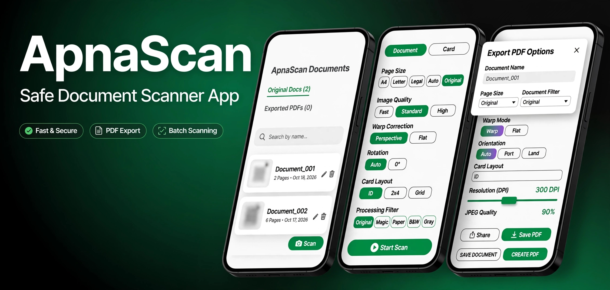

# ApnaScan: Professional Document & ID Scanner

**ApnaScan** is a high-performance, secure mobile document scanning solution engineered for precision and efficiency. Whether you need to digitize physical documents, capture ID cards, or organize complex multi-page scans, ApnaScan provides an intuitive, professional-grade toolkit right in your pocket.

**Live Preview of React App**: [View in AI Studio](https://apnascan.ai.studio)

## 🌟 Key Features

### 📷 Intelligent Scanning
- **Native ML Kit Integration**: Optional Google ML Kit Document Scanner for fast, accurate edge detection and auto-cropping.
- **Multiple Capture Modes**: Specialized workflows for **Documents**, **ID Cards** captures.

### 🎨 Advanced Editing Studio
- **Precise Crop & Rotate**: Manual or auto-detect edge adjustment, with rotation controls.
- **Professional Filters**: Optimize scans with filters including **Original**, **Magic**, **Card**, **Paper**, **B&W**, and **Gray** mode.
- **Manual Tuning**: Fine-tune **Brightness**, **Contrast**, and **Sharpness** to enhance document readability.

### ⚙️ Powerful Workflow
- **QR (QR/Barcode Recognition)**: Extract text/No: directly from scanned documents.
- **Flexible Export**: Generate PDFs with configurable page settings.
- **Batch Processing**: Handle multiple pages seamlessly (up to 50 pages for document mode).
- **High-Performance Architecture**: Zero-copy pixel pipeline utilizing for lightning-fast responsiveness.

## 🛠️ Tech Stack

- **Native Core**: Kotlin, Jetpack Compose
- **AI/ML**: TensorFlow Lite and Google ML Kit (Document Scanner)
- **Image Processing**: OpenCV pipeline.

## 🙏 Credits & Acknowledgement

This app uses open-source libraries under their own permissive licenses (Apache 2.0, MIT, BSD). Their terms apply independently to those components.

## 📄 License

Copyright (c) 2026 ApnaScan. All Rights Reserved.
