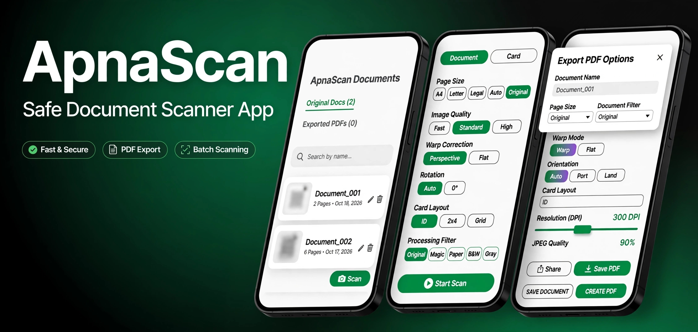

📄 ApnaScan — Professional Document & ID Scanner

Scan Smarter. Edit Better. Stay Organized.

ApnaScan is a powerful, privacy-focused native Android document scanning application designed to turn your smartphone into a professional portable scanner. Capture documents, scan ID cards, enhance images, annotate files, and export high-quality PDFs — all from one intuitive application.

Built with modern Android technologies, ApnaScan combines intelligent document scanning, advanced image processing, on-device machine learning, and professional annotation tools to deliver a fast and efficient scanning experience.

"🚀 Live Preview" (https://apnascan.ai.studio)

---

✨ Key Features

📷 1. Intelligent Document Scanning

- Google ML Kit Document Scanner: Integrated native document scanning experience with automatic edge detection, cropping, and scanning.
- Multiple Capture Modes: Dedicated workflows for documents and ID cards.
- Automatic Edge Detection: Detect document boundaries for accurate cropping.
- Multi-Page Scanning: Capture multiple pages and combine them into a single document.
- High-Quality Capture: Preserve document clarity and readability.
- CameraX Integration: Native camera architecture with lifecycle-aware camera controls.

🎨 2. Advanced Image Editing Studio

Transform ordinary captures into clean, professional-looking scans.

Precision Editing

- Manual cropping with adjustable document boundaries.
- Automatic edge detection and crop assistance.
- Rotate images with precise controls.

Professional Filter Collection

Filter| Purpose
Original| Preserve the original appearance
Magic| Smart document enhancement
Vivid| Enhance colors and details
Card| Optimize ID card appearance
Paper| Create a clean paper-like look
B&W| Classic black and white
B&W 2| Alternative monochrome enhancement
Gray| Professional grayscale output

Manual Image Adjustments

- Brightness
- Contrast
- Saturation
- Sharpness

✍️ 3. Professional Annotation Studio

- Pen & Signature: Freehand drawing and dedicated signature mode.
- Brush & Highlighter: Adjustable brush sizes (2f–50f) and opacity.
- Precision Eraser: Remove annotation layers without modifying the original scan.
- Text Annotations: Customizable fonts, colors, and positioning.
- Undo & Redo: Full annotation history support.
- Clear All: Remove annotations with one action.
- Custom Watermarks: Add text or logo watermarks.
- Color Palette: 8 predefined colors and an eyedropper tool.

🔍 4. QR & Barcode Recognition

- QR code detection and recognition.
- Barcode scanning and data extraction.
- Extract embedded text and numeric information.
- Google Play Services ML Kit integration.

📑 5. Flexible PDF Export

- Generate PDF documents from scanned images.
- Combine multiple pages into a single PDF.
- Configurable page settings.
- Optimized document readability and image quality.

⚡ 6. High-Performance Processing

- Native Kotlin-based Android implementation.
- Optimized image-processing pipeline.
- Custom minimal OpenCV integration.
- Zero-copy pixel pipeline where supported.
- LiteRT support for on-device machine learning.
- Efficient handling of high-resolution scans.

---

🏗️ Architecture & Project Structure

ApnaScan follows a native Android architecture combining modern UI frameworks, lifecycle-aware components, image-processing libraries, and dependency injection.

Architecture Overview

Layer / Component| Technology| Responsibility
UI Layer| Jetpack Compose| Modern declarative UI
Legacy UI Support| ViewBinding| Native Android view integration
Navigation| Android Navigation Component| Fragment-based navigation
Camera Layer| CameraX| Camera capture and lifecycle management
Image Processing| OpenCV 4.11.0| Image enhancement and processing
AI / ML| Google ML Kit| Document scanning and barcode recognition
On-device ML| Google AI Edge LiteRT| TensorFlow Lite successor runtime
State Management| Lifecycle & ViewModel| UI state and lifecycle management
Asynchronous Tasks| Kotlin Coroutines| Background operations
Dependency Injection| Dagger Hilt| Dependency management
Image Loading| Coil 3| Asynchronous image loading
Local Preferences| DataStore| Persistent application preferences

🧩 Dependencies & Libraries

ApnaScan uses carefully selected Android libraries for camera functionality, image processing, AI integration, UI development, and application infrastructure.

1. AndroidX & Material Components

Dependency| Version
AndroidX Core KTX| 1.19.1
AppCompat| 1.8.0
Material Components| 1.13.0
ConstraintLayout| 2.2.2

2. CameraX

<text>Version: 1.6.2</text>

- "camera-core"
- "camera-camera2"
- "camera-lifecycle"
- "camera-view"
- "camera-extensions"

Provides native camera capture infrastructure and lifecycle-aware camera integration.

3. Computer Vision & Image Processing

OpenCV 4.11.0

- Custom minimal OpenCV AAR integration.
- ARM64-optimized native library.
- Stripped native binaries for reduced application size.
- Image-processing pipeline for document enhancement.

<text>OpenCV is included through local AAR files in the "app/libs" directory.</text>

4. AI & Machine Learning

Library| Version| Purpose
Google AI Edge LiteRT| 2.3.0| On-device ML inference
ML Kit Barcode Scanning| 18.3.1| QR and barcode recognition
ML Kit Document Scanner| 16.0.0| Native document scanning

LiteRT is used as the successor runtime to TensorFlow Lite for supported on-device machine learning workflows.

5. Jetpack Compose

Compose BOM: 2026.09.00

- Compose UI
- Compose Graphics
- Material 3
- Material Icons Extended
- UI Tooling Preview
- Compose Runtime
- Runtime LiveData
- Activity Compose 1.13.0

Provides a modern declarative UI development environment.

6. Lifecycle, Coroutines & Navigation

Dependency| Version
Lifecycle ViewModel KTX| 2.10.0
Lifecycle Runtime KTX| 2.10.0
Kotlin Coroutines Android| 1.9.0
Kotlin Coroutines Play Services| 1.9.0
Navigation Component| 2.10.2

7. Dependency Injection

Dagger Hilt 2.60.1

- Hilt Android
- Hilt KSP Compiler

Provides dependency injection and simplifies application component management.

8. Image Loading & Local Storage

Library| Version| Purpose
Coil Compose| 3.6.3| Asynchronous image loading
DataStore Preferences| 1.3.0| Persistent preference storage

9. Testing Dependencies

Library| Version
JUnit| 4.13.2
AndroidX Test Core| 1.5.0
AndroidX Test Rules| 1.5.0
AndroidX Test JUnit| 1.1.5
Espresso Core| 3.5.1

---

⚙️ Build Configuration

ApnaScan uses a modern Android Gradle Kotlin DSL configuration.

Configuration| Value
Namespace| "com.apnascan"
Application ID| "com.apnascan"
Compile SDK| 37
Target SDK| 37
Minimum SDK| 26 (Android 8.0)
Build Tools| 37.0.0
Version Code| 1
Version Name| 1.0.0
Java Compatibility| Java 17
Kotlin JVM Target| JVM 17
Native ABI| ARM64-v8a

Build Features

- Jetpack Compose enabled.
- ViewBinding enabled.
- BuildConfig generation enabled.
- KSP-based annotation processing.
- Hilt dependency injection.
- Release code shrinking with R8.
- Resource shrinking enabled.
- Optimized native library packaging.

Localization Support

The build configuration retains the following application resource locales:

- English ("en")
- Hindi ("hi")
- Urdu ("ur")
- Sindhi ("sd")

Asset Optimization

The following file formats are configured for uncompressed asset packaging:

- TensorFlow Lite models (".tflite")
- PDF files (".pdf")
- Database files (".db")

---

🔏 Release & Signing Configuration

ApnaScan supports configurable release signing for local development and CI/CD environments.

Supported signing configuration sources:

1. "signing.properties" for local release builds.
2. Environment variables for CI/CD signing.

Supported environment variables:

ANDROID_KEYSTORE_FILE
ANDROID_KEYSTORE_PASSWORD
ANDROID_KEY_ALIAS
ANDROID_KEY_PASSWORD

Release optimizations:

- R8 code minification.
- Resource shrinking.
- Optimized ProGuard configuration.
- V1, V2, V3 and V4 APK signing schemes.

Security recommendation: Never commit keystore files, signing passwords, or private signing credentials to a public repository.

---

🔐 Privacy & Offline-First Experience

Your documents should remain yours.

- No Ads: Clean, uninterrupted scanning experience.
- No Watermarks: Export without forced branding.
- Local Processing: Designed around on-device document processing.
- Offline-First: Core scanning and editing workflows are designed to work offline.
- Privacy-Focused: No account is required for the core scanning experience.

Note: Google Play Services-based ML Kit features may depend on Google Play Services and their model availability. Internet connectivity may be needed for initial component or model delivery.

---

🎯 Designed For

- Students scanning notes and assignments.
- Professionals digitizing business documents.
- Users capturing identity cards and personal documents.
- Freelancers signing and annotating documents.
- Anyone who needs a portable document scanner.

---

🙏 Credits & Acknowledgements

ApnaScan uses open-source libraries and third-party technologies under their respective licenses.

Special thanks to the developers and communities behind:

- Kotlin
- AndroidX
- Jetpack Compose
- Google ML Kit
- Google AI Edge LiteRT
- OpenCV
- Dagger Hilt
- Coil

All third-party components remain subject to their respective license terms.

---

📄 License

Copyright © 2026 ApnaScan. All Rights Reserved.

ApnaScan's original source code and branding are proprietary unless explicitly stated otherwise. Third-party libraries retain their respective licenses.

---

📄 ApnaScan

Your Documents. Your Privacy. Your Control.

Scan • Enhance • Annotate • Export

"🚀 Open Live Preview" (https://apnascan.ai.studio)

